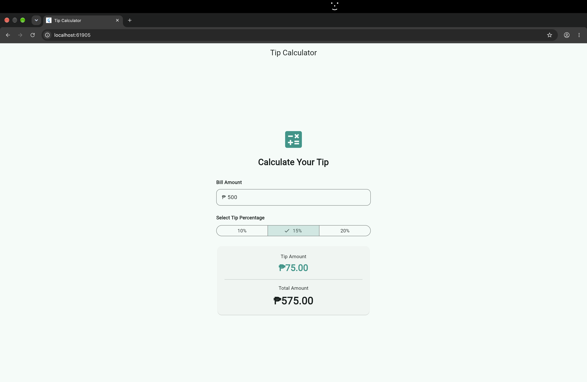
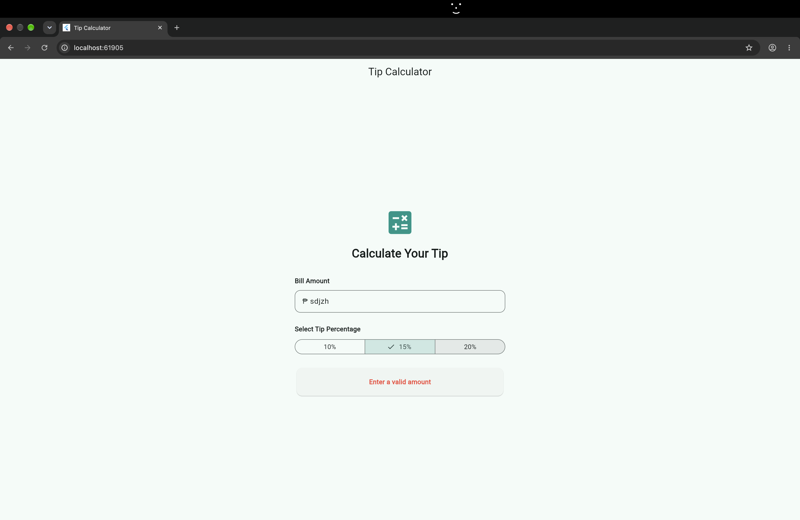

# Tip Calculator

**Student Name:** Emmanuel D. Mirabel

## Description
A Flutter application that calculates tip amounts and total bills using selected percentage rates.

## Features
- Enter bill amount.
- Select 10%, 15%, or 20% tip.
- Automatically calculate tip.
- Display total bill.
- Validate invalid input.

## Technologies
- Flutter
- Dart
- Visual Studio Code

## Screenshots

### Tip Calculator

### Invalid Amount

## Testing
- flutter analyze
- flutter test
